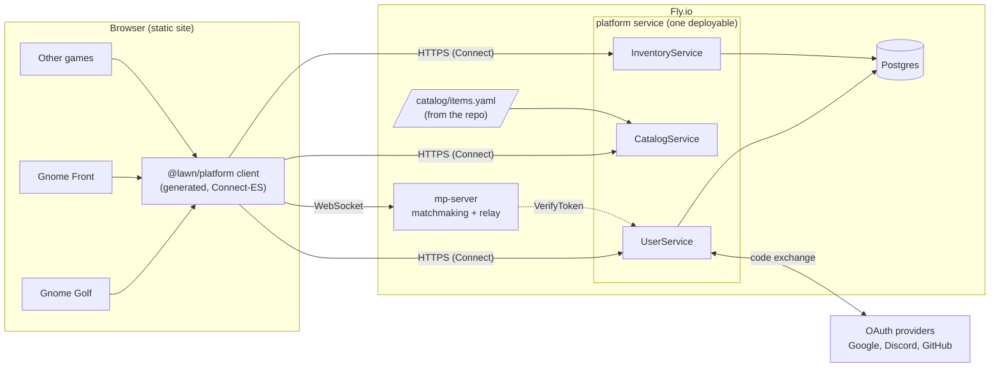
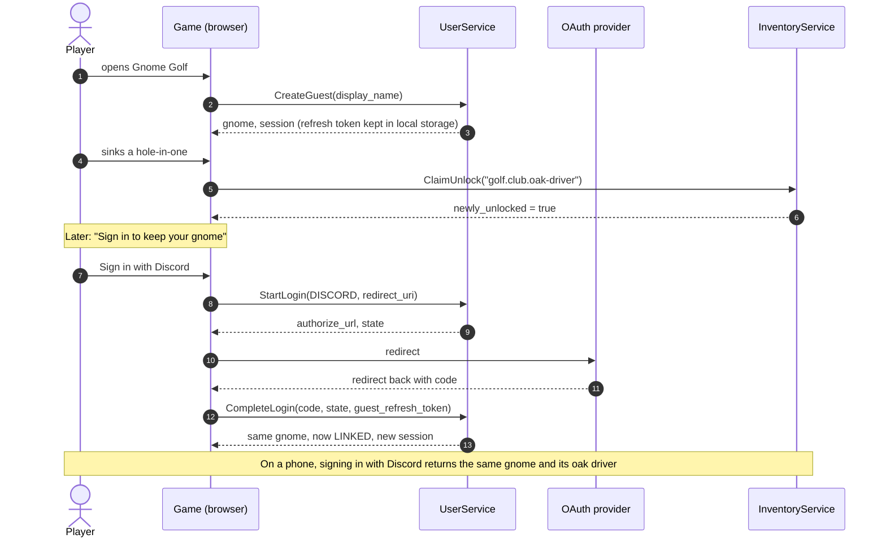
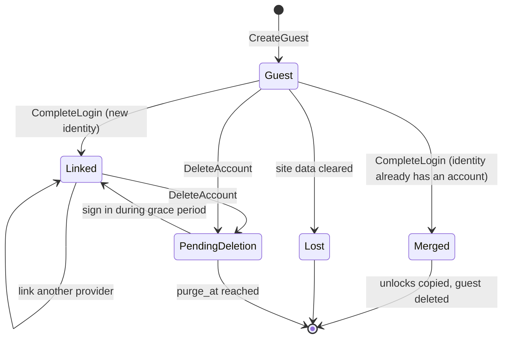
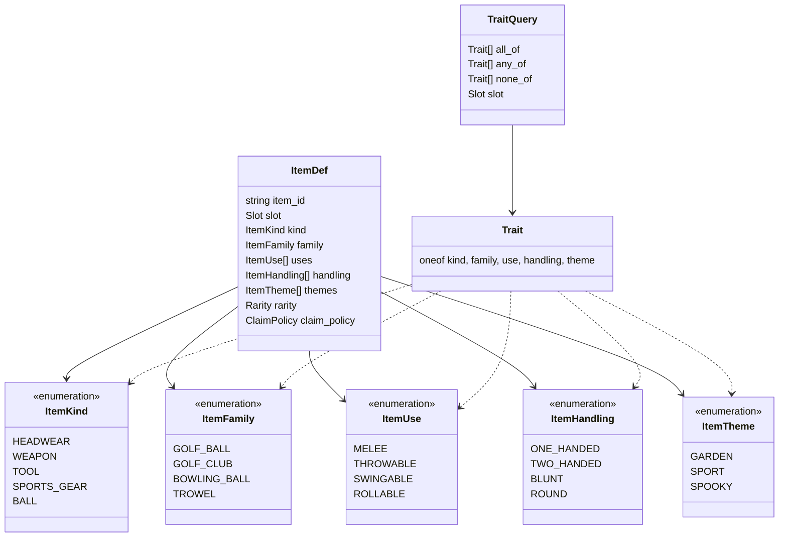
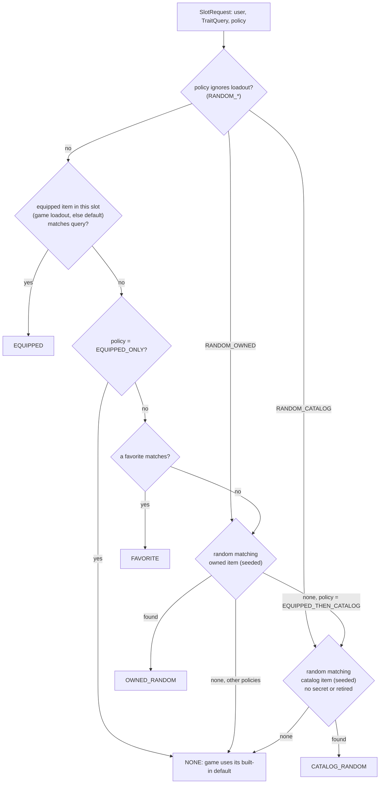
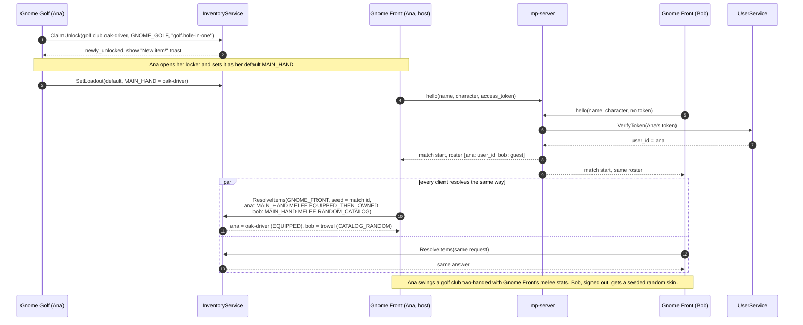
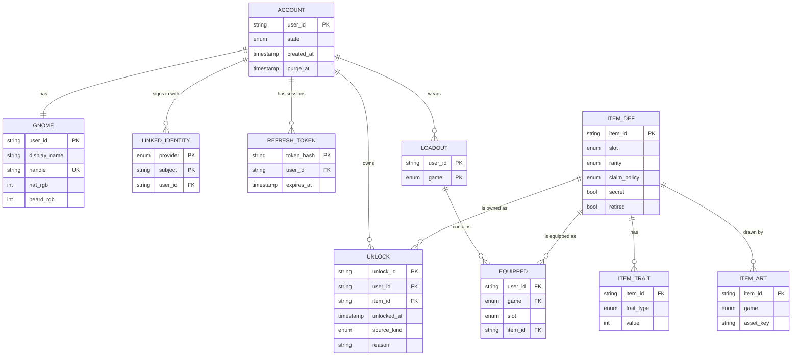
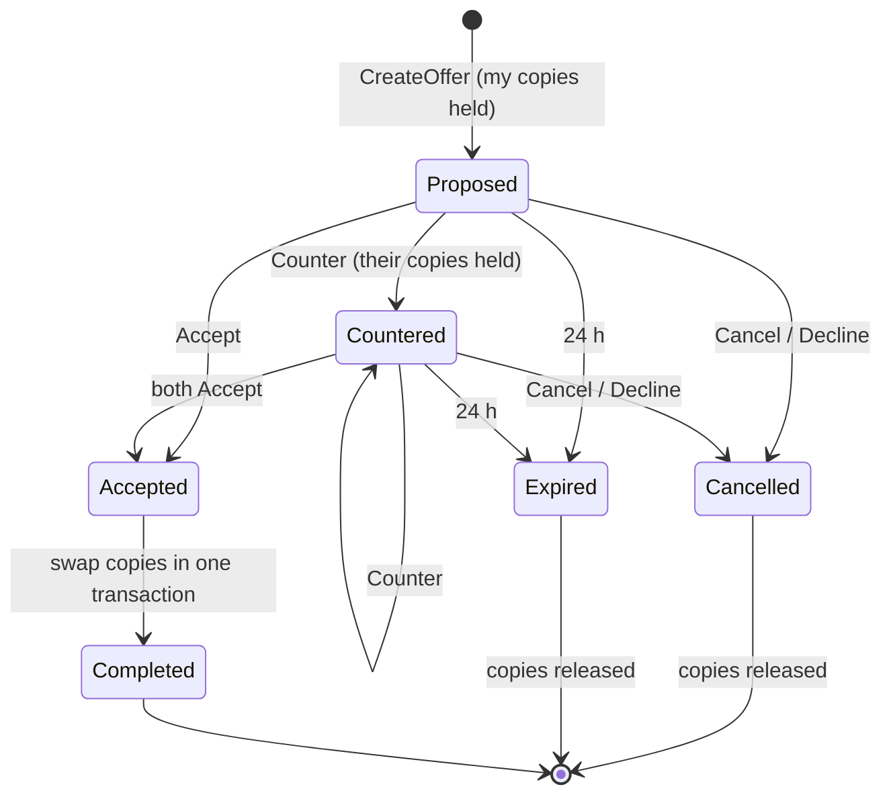

# Gnome Platform: users, unlocks and cosmetics shared by every game

Status: proposal. This PR adds the protobuf API only (`proto/`). Nothing is implemented.

## Why

The arcade has six gnome games and one shared matchmaking server. Each game keeps its own progress in local
storage, so nothing a player earns goes anywhere else. A small platform service gives every player one gnome that
carries its cosmetics from game to game: a golf club won in Gnome Golf can be swung in Gnome Front, a bowling ball
can be put in play on the golf course.

## Scope

| Tier | Service | What it does | In this PR |
|---|---|---|---|
| 1 | **User** | Guest accounts, OAuth sign-in, the public gnome (name, base colours) | protos |
| 1 | **Inventory** (+ Catalog) | Item catalog with typed traits, which items each gnome has unlocked, loadouts, item picking | protos |
| 2 | Trade | Swapping unlocks between players | sketch below |
| 3 | Social | Parties, then friends | case for and against below |

Non-goals for v1: item quantities or copies, trading, a shop or money, friends, chat, server-side checks of game
results.

## Principles

1. **Playing never needs an account.** Sign-up is a cost (SOUL.md). Every game must keep working with no session,
   exactly as today. Signing in only adds a gnome that persists and unlocks that follow it.
2. **Items are cosmetic.** An item never changes damage, speed or score. Traits say which of a game's *own*
   mechanics an item can dress up. The golf club in Gnome Front is a skin on Gnome Front's two-handed melee swing,
   with Gnome Front's numbers. This keeps balance in each game and keeps cheating harmless.
3. **The platform knows traits; games know mechanics.** The platform never says "this does 12 damage". A game asks
   for "anything MELEE, not TWO_HANDED, for the main hand" and decides what that looks like.
4. **Code over clicking.** The catalog is a data file in the repo, loaded at deploy. Adding an item is a PR.
5. **Collect as little as possible.** We store the OAuth provider's subject id, never an email or real name.

## Architecture

The platform is its own stateful service. The static game site and the matchmaking relay stay as they are; the
relay gains one optional field (the player's access token) so a match can show who is who.

Transport: protobuf over [Connect](https://connectrpc.com), which speaks plain HTTP + JSON from a browser (no gRPC-web
proxy) and real gRPC between services. TypeScript clients are generated with `buf generate` into a shared package
once a game uses them.

## User service

`proto/gnome/user/v1/user.proto`

- **Guest first.** On first use a game calls `CreateGuest` and keeps the refresh token in local storage. The
  player has a gnome and can unlock things without signing in.
- **Sign in to keep it.** `StartLogin` / `CompleteLogin` (OAuth code flow) link the guest to a Google, Discord or
  GitHub identity, so the gnome survives a cleared browser and works on a phone too. If that identity already has
  an account, the guest's unlocks are merged into it.
- **Sessions.** 15-minute JWT access tokens (other services can verify them locally) and single-use, rotating
  refresh tokens.
- **The gnome.** `display_name` (filtered with the same `checkName` as online play, not unique), a server-assigned
  unique `handle` (unused until social), and free base colours.

### Flow: first visit, then sign in on another device

### Account lifecycle

## Inventory service

`proto/gnome/inventory/v1/catalog.proto` and `inventory.proto`

### Items: slot + typed traits

Each `ItemDef` has exactly one **slot** (where it goes on the gnome, or which game object it replaces) and a field
per **trait type**. Each trait type is its own enum. A new kind of trait becomes a new enum and a new field, never
extra values tucked into an existing enum.

| Field | Type | How many | Answers | Examples |
|---|---|---|---|---|
| `kind` | `ItemKind` | one | What is it broadly? | HEADWEAR, WEAPON, TOOL, BALL, VEHICLE |
| `family` | `ItemFamily` | zero or one | Which specific thing is it? | GOLF_BALL, GOLF_CLUB, BOWLING_BALL, LAWN_MOWER |
| `uses` | `ItemUse` | many | Which mechanic can it skin? | MELEE, THROWABLE, SWINGABLE, ROLLABLE, RIDEABLE |
| `handling` | `ItemHandling` | many | What does a game need to animate it or combine it? | ONE_HANDED, TWO_HANDED, BLUNT, HEAVY, FLOATS |
| `themes` | `ItemTheme` | many | Which set does it belong to? | GARDEN, SPORT, SPOOKY |

How the examples from the brief come out:

| Item | Slot | Kind | Family | Uses | Handling | Themes |
|---|---|---|---|---|---|---|
| Oak driver (golf) | MAIN_HAND | SPORTS_GEAR | GOLF_CLUB | SWINGABLE, MELEE | TWO_HANDED, BLUNT, LONG | SPORT |
| Garden trowel | MAIN_HAND | TOOL | TROWEL | MELEE, THROWABLE | ONE_HANDED, SHARP | GARDEN |
| Mossy golf ball | BALL | BALL | GOLF_BALL | PROJECTILE, THROWABLE | ROUND, BOUNCY, LIGHT | |
| Bowl-cut bowling ball | BALL | BALL | BOWLING_BALL | ROLLABLE, THROWABLE | ROUND, HEAVY | |
| Pot-lid shield | OFF_HAND | ACCESSORY | | SHIELD | ONE_HANDED, BLUNT | GARDEN |

Queries use `TraitQuery`. A `Trait` is a oneof over the five trait enums, so one query can mix types:

- Gnome Front, random melee for a gnome holding a shield:
  `{slot: MAIN_HAND, all_of: [{use: MELEE}], none_of: [{handling: TWO_HANDED}]}`
- Gnome Front, the player's chosen melee: same query, `EQUIPPED_THEN_OWNED`. Their oak driver matches, so they
  swing it (two-handed animation, because its handling includes TWO_HANDED).
- Gnome Golf, the player's ball: `{slot: BALL, all_of: [{family: GOLF_BALL}]}`. A fun mode could use
  `all_of: [{handling: ROUND}]` and put a bowling ball on the tee.

Rule of thumb: game code queries **uses** and **handling**; **family** is for explicit lookups ("any golf ball")
and collections. That way a new item works in every game whose question it answers, with no game change.

#### Why typed enums, not free strings or key/value traits

- **One enum per trait type (chosen).** Typos are compile errors in every game, each type's values are listed
  together, and a field's type says what it holds (an `ItemUse` can't end up in `handling`). Adding a value is a
  one-line PR. proto3 keeps unknown enum values, so an older game build ignores a new value. Cost: a proto release
  per new value, which here is the same PR that adds the item.
- **Free strings.** No release needed, but `"two-handed"`, `"two_handed"` and `"2h"` will all appear, and no tool
  catches it.
- **Traits with numeric values** (`hands: 2`, `reach: 1.4`). More precise, but values invite stats, and stats
  break principle 2. Every real question so far ("needs two hands?", "can I throw it?") is a yes/no. If a numeric
  trait is ever needed, it becomes its own typed field.

#### Art across games

The platform stores no files. `ItemDef.art` maps a game to a key in that game's own bundled asset table. A game
with no art for an item draws a generic shape for its traits (a generic two-handed blunt weapon, a generic ball),
tinted with `primary_rgb` / `secondary_rgb`. So the oak driver works in Gnome Front on day one as a brown stick,
and gets a proper mesh when someone adds one.

### Unlocks

v1 tracks unlocks only: a gnome has an item or it does not. `Unlock` rows still get an `unlock_id` so trade can
refer to one later without a schema change.

How an item becomes unlockable is the item's `claim_policy`:

- `STARTER`: everyone has it.
- `CLIENT_CLAIM`: the game client calls `ClaimUnlock` after the player earns it. Only games listed in the item's
  `claimable_from` may claim it.
- `SERVER_GRANT`: only a service or admin can grant it (events, promo codes).

**Trust.** Games run in the browser and the match host is a player's browser, so a client claim can be faked.
For cosmetics with no stats that is an acceptable risk in v1, limited by: per-game claim lists, per-user rate
limits, idempotency keys, and an audit trail (`UnlockSource`). Anything rare or valuable uses `SERVER_GRANT`. If
trade arrives, faked unlocks gain value, and that is the point to add server-side checks (see Trade).

### Loadouts and picking items

A gnome has a **default loadout** and optional **per-game loadouts**. For each slot the game's loadout wins, else the
default. `SetLoadout` checks ownership, slots, and the two-handed rule (a TWO_HANDED main-hand item leaves the off
hand empty). Loadouts also hold `favorite_item_ids`, used when a game must pick for a slot the player left empty.

`ResolveItems` is the one call a game makes to get the item for a slot, for players and bots alike. It is seeded,
so every client in a match makes the same call and gets the same answer with no extra network messages.

### Flow: a golf club goes to war

The mp change this implies (later, not in this PR): `hello` gains an optional `token`, and roster entries gain an
optional verified `user_id`. The relay never trusts a `user_id` a client sends.

### Data model

`ITEM_DEF`, `ITEM_TRAIT` and `ITEM_ART` are loaded from `catalog/items.yaml` at deploy, not edited at runtime.

## Tier 2: trade (sketch, not in this PR)

Trading turns "has an item" into "has a copy of an item", which is the real change:

- **Copies.** An `Unlock` becomes an owned copy (the `unlock_id` reserved now). Items gain `tradable`. Starter and
  event items stay untradable.
- **Offers with escrow.** A `TradeService` holds both sides' copies in escrow while an offer is open, so neither
  side can trade the same copy twice. Both accept, then the service moves the copies in one transaction.
- **Trust has to go up first.** Once items can be traded they have value, and faked `ClaimUnlock` calls become
  worth doing. Before trade ships, tradable items need a server-checked source (`SERVER_GRANT`, or a game result
  the server can check). Untradable client-claimed items can stay as they are.
- **Abuse.** Scams and real-money trading follow tradable items. Expect a trade cooldown on new accounts and
  linked (not guest) accounts only.

## Tier 3: social, for and against

### For

- **The pain is real.** Today, playing with a friend means reading a room code aloud, and doing it again for each
  game. A party that follows you from Gnaft to Gnome Golf to Gnome Bowling is the thing a multi-game arcade is
  best placed to offer.
- **It gives cosmetics an audience.** Cosmetics are worth earning when the people you play with see them.
- **Presence is cheap to show.** mp-server already knows who is in which match; "Bob is in Gnaft, join?" is mostly
  plumbing.

### Against

- **Moderation.** Friend requests and invites are a harassment channel. Blocking, reporting and someone to read the
  reports must exist before the first friend request does. On a hobby project that is the most expensive part.
- **Young players.** Gnome games will attract kids. Social graphs and contact between strangers carry legal and
  ethical weight (COPPA in the US, age-appropriate design codes in the UK and EU) that a cosmetics locker does not.
- **Empty rooms.** With a small player base, a friends list is mostly empty. Room codes already work for people
  who know each other.
- **Accounts become required.** Friends need persistent identity, which pushes against "playing never needs an
  account".
- **New stateful infrastructure.** Presence and invites need long-lived connections and fan-out, which the
  platform service otherwise does not need.

### Recommendation

Do not build friends yet. Build it in this order, each step only once the previous one is used:

1. **Parties without friends.** A party code that survives the end of a match and carries the group into the next
   game. No accounts, no graph, no requests. This belongs in mp-server, not the platform.
2. **Recent players.** "People you played with this week" from match rosters, for signed-in players only. Gives
   most of a friends list's value with no requests to moderate.
3. **Block and report**, then **friends by handle** (the `handle` field is reserved for this), linked accounts
   only.

## Before anything ships

- `PRIVACY.md` says "No accounts". It must be updated to describe guest and linked accounts, what is stored (the
  provider subject id, display name, unlocks, loadouts), deletion, and the grace period.
- Pick the database and hosting (Postgres on Fly is assumed above).
- Decide whether the catalog file lives at `catalog/items.yaml` or next to the protos.

## Open questions

1. Should guests expire (for example after 90 days without a visit) to keep the table small?
2. One gnome per account, or several (a "main" and alts)? v1 assumes one.
3. Do games ever want a per-game look beyond loadouts, for example a Gnome Front team colour overriding
   `coat_rgb`? Proposed: no, games may tint over the gnome however they like at render time.
4. Should `ResolveItems` be callable without a session (bots, signed-out players)? Proposed: yes, it is
   `[open]`, since loadouts are public and catalog picks reveal nothing.
